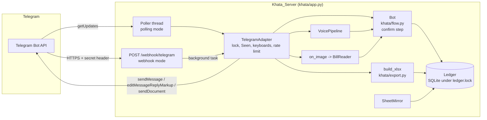
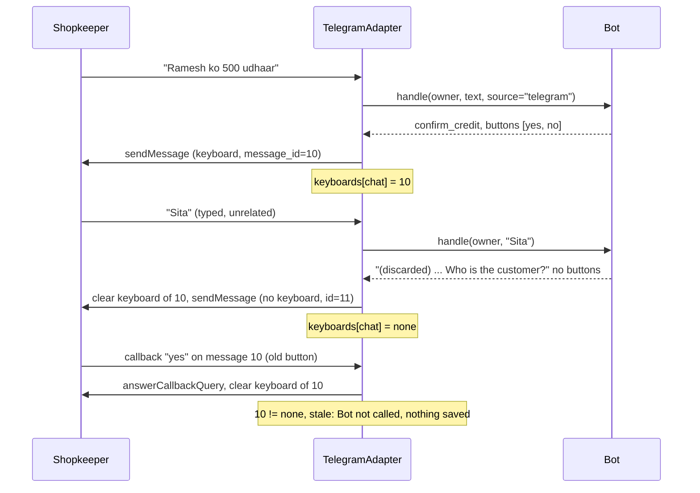

# Design Document: Telegram Channel

## Overview

Telegram becomes Khata's primary shopkeeper chat channel. A new module `khata/telegram.py`
holds four parts:

- `TelegramAPI`: a thin httpx client for the Telegram Bot API.
- `TelegramAdapter`: turns Telegram updates into `Bot.handle` / `on_image` calls and sends the
  replies, with dedupe, owner hashing, private-chat and allow-list checks, a rate limit, and the
  stale-button rule.
- `Poller`: long-polls `getUpdates` on a daemon thread (local runs, no public URL).
- `make_router`: the `POST /webhook/telegram` route (Render, where an inbound request wakes the
  sleeping free-plan service).

The adapter follows the WhatsApp adapter's shape (`khata/whatsapp.py`): the same `Bot`, the same
`VoicePipeline`, the same `on_image` callback that `create_app` already builds for bills, and
`Seen` for dedupe. It never writes to the ledger; every save still needs the confirm step in
`khata/flow.py`.

Smaller changes support it:

- `khata/export.py` gets `build_xlsx(ledger, owner) -> bytes`, used by `/api/export.xlsx` and by
  Telegram `/export`.
- `khata/flow.py` gets a trilingual `export_doc` message for `source == "telegram"`.
- `khata/app.py` wires the adapter, starts the poller or sets the webhook inside a FastAPI
  lifespan, and reports Telegram in `/health` and the Lab panel.
- The sheet mirror and khata-mcp can take their owner from a Telegram chat id
  (`KHATA_SHEET_OWNER_TELEGRAM_ID`).
- Config (`.env.example`, `render.yaml`), docs and steering mention Telegram. WhatsApp stays,
  marked optional.

### Research findings

- **Telegram Bot API** ([core.telegram.org/bots/api](https://core.telegram.org/bots/api)):
  `getUpdates` and webhooks are mutually exclusive. `getUpdates` returns 409 Conflict while a
  webhook is set or another client is polling, so the poller calls `deleteWebhook` first and
  only one process may poll. An update is confirmed once `getUpdates` is called with an offset
  greater than its `update_id`. `setWebhook` accepts a `secret_token` of 1 to 256 characters
  from `A-Z a-z 0-9 _ -`, which Telegram returns in the `X-Telegram-Bot-Api-Secret-Token`
  header. Callback queries must be answered with `answerCallbackQuery` or the client shows a
  spinner. `getFile` serves files up to 20 MB; Khata's own cap is 10 MB. Voice notes arrive as
  OGG/Opus with a `.oga` file path, which `voice.py` already accepts.
- **Render Blueprint `generateValue`** ([render.com/docs/blueprint-spec](https://render.com/docs/blueprint-spec)):
  the generated value is a base64-encoded 256-bit value such as `B0jr...KFUk=`. It can contain
  `=`, `+` and `/`, which Telegram rejects in `secret_token`. **Design consequence:** Khata
  never sends `TELEGRAM_WEBHOOK_SECRET` raw. It sends `webhook_token(secret)`, a SHA-256 hex
  digest (64 characters, all allowed), and compares the header against that same digest.
- **Render `sync: false`** (same page): Render prompts for `sync: false` variables only when a
  Blueprint is first created and ignores new ones on later Blueprint updates. An existing
  deployment must add `TELEGRAM_BOT_TOKEN` by hand in the dashboard. `docs/TELEGRAM.md` says so.
- **httpx errors** include the request URL in their message, and the URL contains the bot
  token. `TelegramAPI` therefore raises `TelegramError(...) from None` with only the method name
  and the exception type name, and scrubs the token from any Telegram `description` as a
  second guard.

## Architecture



### Confirm flow with stale-button safety



### Modes

| `TELEGRAM_MODE` | Where | Startup (inside lifespan) | Inbound path |
|---|---|---|---|
| `polling` (default, and any value other than `webhook`) | Laptop | `Poller.start()`; the thread calls `delete_webhook()` once | `getUpdates` long poll |
| `webhook` | Render free plan | `await asyncio.to_thread(api.set_webhook, KHATA_PUBLIC_URL + "/webhook/telegram", webhook_token(secret))` | `POST /webhook/telegram` |

The channel is **off** when `TELEGRAM_BOT_TOKEN` (or the injected `telegram_api`) is missing,
when `KHATA_OWNER_SALT` is empty, or when `TELEGRAM_ALLOWED_CHAT_IDS` contains an entry that is
not an integer. An unsalted SHA-256 of a chat id can be reversed by brute force over the id
space, so the salt is mandatory. A mistyped allow-list must not silently become an empty list,
because an empty list means "everyone".

### Design decisions

| Decision | Alternatives | Reason |
|---|---|---|
| Own httpx client, no bot framework | python-telegram-bot, aiogram | Six methods are needed. A framework brings its own event loop and threading model that would fight the shared `ledger.lock`. httpx is already a dependency. |
| Adapter is synchronous with one `threading.Lock` | asyncio adapter | `Bot.handle`, `VoicePipeline` and `BillReader` are blocking. The poller thread and webhook background tasks (run in Starlette's thread pool) both call `handle_update`; one lock gives one-update-at-a-time ordering, which the stale-button rule needs. |
| Lifespan starts network work | Start in `create_app` | `app = create_app()` runs at import and tests build many apps. Network threads must only start when a server actually starts. |
| `webhook_token(secret)` = SHA-256 hex | Send secret raw | Render's generated value can contain characters Telegram rejects. |
| Stale-button rule keyed on message id | Expire buttons by time | Message id identifies exactly which proposal a tap belongs to. A time limit would still let an old tap confirm a newer, different entry. |
| Plain text (no `parse_mode`) | Markdown/HTML | Customer names and transcripts are untrusted; parse modes fail on stray `*` or `<` and would let transcribed text inject formatting. |

## Components and Interfaces

### `khata/export.py` (new)

```python
HEADER = ["id", "customer", "kind", "rupees", "date", "due", "status"]

def build_xlsx(ledger: Ledger, owner: str) -> bytes:
    """One row per entry of `owner`, cancelled included, in ledger order. rupees = paise / 100."""
```

`/api/export.xlsx` in `app.py` becomes `StreamingResponse(io.BytesIO(build_xlsx(ledger, o)), ...)`
with the same media type and `Content-Disposition`. The rupees column keeps the existing
`paise / 100` display value; the ledger itself stays integer paise.

### `khata/flow.py` (changed)

- `M["export_doc"]`:
  - en: "Here is your khata as an Excel file."
  - hi: "आपका खाता Excel फ़ाइल में भेज रहा हूँ।"
  - pa: "ਤੁਹਾਡਾ ਖਾਤਾ Excel ਫ਼ਾਈਲ ਵਿੱਚ ਭੇਜ ਰਿਹਾ ਹਾਂ।"
- In `_fresh`, the export branch adds, before the WhatsApp check:
  `if source == "telegram": return self._r(self.say("export_doc", lang), export=True)`.

No other flow changes. Callbacks reach the Bot as ordinary text (`"yes"`, `"no"`, `"credit"`,
`"payment"`), exactly like WhatsApp button ids.

### `khata/telegram.py` (new)

Constants:

```python
API_BASE = "https://api.telegram.org"
FILE_MAX = 10 * 1024 * 1024
ALLOWED_UPDATES = ["message", "callback_query"]
BUTTON_TITLES = {"yes": "✅ Yes / हाँ", "no": "❌ No / नहीं",
                 "credit": "Credit / उधार", "payment": "Payment / जमा"}
ERROR_REPLY = "Something went wrong. Nothing was saved. Please try again."
PRIVATE_ONLY = "Please message me privately. Khata only works in a one-to-one chat."
UNSUPPORTED = "I can read text, voice notes and bill photos."
TOO_LARGE = "That photo is too large. Please send a smaller one."
RATE_PER_MIN = 30
COMMANDS = {"start": "help", "help": "help", "export": "export",
            "list": "list", "undo": "undo", "remind": "remind"}    # "id" is handled by the adapter
log = logging.getLogger("khata.telegram")
```

Pure helpers:

```python
def owner_for_chat(chat_id: int | str, salt: str) -> str:
    """'tg-' + sha256(f'{salt}:tg:{int(chat_id)}').hexdigest()[:24]. Raises ValueError on a non-integer id."""

def webhook_token(secret: str) -> str:
    """sha256('khata-tg:' + secret).hexdigest(): 64 chars from [0-9a-f], valid as Telegram's secret_token."""

def parse_allowed(raw: str | None) -> frozenset[int]:
    """'123, 456' -> {123, 456}; '' or None -> empty set. Raises ValueError on any non-integer entry."""

def command_of(text: str) -> str | None:
    """'/Export@KhataBot extra' -> 'export'; returns None when text does not start with '/'."""

def pick_photo(sizes: list[dict], limit: int) -> dict | None:
    """Largest size (by width*height, then file_size) with file_size <= limit; missing file_size counts as 0."""

def next_delay(delay: float) -> float:
    """Backoff step: min(60, delay * 2)."""
```

#### `TelegramError(Exception)`

Message format: `"<method>: <description or exception type name>"`. Never contains the token.

#### `TelegramAPI`

```python
class TelegramAPI:
    def __init__(self, token: str, http=None):
        self._token = token
        self.http = http or httpx.Client(timeout=35)     # > long-poll timeout of 25 s

    def _call(self, method: str, *, json=None, data=None, files=None, timeout: float = 20):
        url = f"{API_BASE}/bot{self._token}/{method}"
        try:
            r = self.http.post(url, json=json, data=data, files=files, timeout=timeout)
            body = r.json()
        except Exception as ex:
            log.warning("telegram %s failed: %s", method, type(ex).__name__)
            raise TelegramError(f"{method}: {type(ex).__name__}") from None
        if not body.get("ok"):
            desc = str(body.get("description") or "error").replace(self._token, "***")
            raise TelegramError(f"{method}: {desc}")
        return body.get("result")

    def get_updates(self, offset: int | None, timeout: int = 25) -> list[dict]
        # getUpdates {"offset", "timeout", "allowed_updates": ALLOWED_UPDATES}, http timeout = timeout + 10
    def send_message(self, chat_id: int, text: str, buttons: list[str] | None = None) -> int
        # sendMessage {"chat_id", "text": text[:4096]} (+ "reply_markup": {"inline_keyboard": [[
        #   {"text": BUTTON_TITLES.get(b, b), "callback_data": b[:64]} for b in buttons]]}); returns result["message_id"]
    def answer_callback(self, callback_id: str) -> None            # answerCallbackQuery
    def clear_buttons(self, chat_id: int, message_id: int) -> None # editMessageReplyMarkup, reply_markup {"inline_keyboard": []}
    def download(self, file_id: str) -> tuple[bytes, str]
        # getFile -> {"file_path", "file_size"}; reject file_size > FILE_MAX;
        # GET f"{API_BASE}/file/bot{token}/{file_path}" (same try/except/from None wrapping); reject len(content) > FILE_MAX
    def send_document(self, chat_id: int, filename: str, data: bytes, caption: str = "") -> None
        # sendDocument multipart: data={"chat_id", "caption": caption[:1024]}, files={"document": (filename, data, xlsx mime)}
    def set_webhook(self, url: str, secret_token: str) -> None
        # setWebhook {"url", "secret_token", "allowed_updates": ALLOWED_UPDATES, "drop_pending_updates": False}
    def delete_webhook(self) -> None                               # deleteWebhook
```

`TelegramAPI` defines no `__repr__` that includes the token, and the token attribute is private.

#### `TelegramAdapter`

```python
class TelegramAdapter:
    def __init__(self, bot: Bot, voice: VoicePipeline, api, *, on_image: Callable | None,
                 export: Callable[[str], bytes] | None, salt: str,
                 allowed: frozenset[int] = frozenset(), clock=time.monotonic,
                 image_limit: int = bills.MAX_IMAGE):
        self.lock = threading.Lock()
        self.seen = Seen()                       # from khata.whatsapp
        self.keyboards: dict[int, int] = {}      # chat_id -> Latest_Keyboard message id
        self.hits: dict[int, deque] = defaultdict(deque)

    def handle_update(self, update: dict) -> None:
        with self.lock:
            uid = update.get("update_id")
            if uid is None or not self.seen.add(str(uid)):
                return
            if "callback_query" in update: self._on_callback(update["callback_query"])
            elif "message" in update:      self._on_message(update["message"])
```

Gate (`_admit(chat) -> bool`), applied to messages and callbacks in this order:

1. `chat_id = chat["id"]`. If `self.allowed` is non-empty and `chat_id not in self.allowed`:
   return False with no reply (do not reveal the bot to strangers).
2. If `chat.get("type") != "private"`: send `PRIVATE_ONLY` and return False.
3. Rate limit: drop timestamps older than 60 s from `self.hits[chat_id]`; if 30 remain, return
   False with no reply; otherwise append `clock()` and return True.

`_on_message(msg)` (inside `try/except Exception`, which logs `type(ex).__name__` and sends
`ERROR_REPLY`):

| Message | Action |
|---|---|
| `text` starting with `/` and `command_of == "id"` | send `f"Your chat id is {chat_id}. Put it in KHATA_SHEET_OWNER_TELEGRAM_ID to link the Google Sheet."` |
| `text` with `command_of` in `COMMANDS` | `bot.handle(owner, COMMANDS[cmd], source="telegram")` |
| other `text` | `bot.handle(owner, text[:1000], source="telegram")` |
| `voice` or `audio` | `data, path = api.download(file_id)`; `suffix = Path(path).suffix.lower() or ".oga"`; `voice.transcribe(data, suffix)`; on `VoiceError` send its message; else send `🎙️ Heard: “{text}”`, then `bot.handle(owner, text, source="voice")` |
| `photo` | `size = pick_photo(msg["photo"], image_limit)`; `None` → send `TOO_LARGE`; else `on_image(owner, data, "image/jpeg")` |
| `document` with `mime_type` starting `image/` | `file_size > image_limit` → `TOO_LARGE`; else `on_image(owner, data, mime_type)` |
| anything else | send `UNSUPPORTED` |

`_on_callback(cq)`:

1. `api.answer_callback(cq["id"])` (best effort: a failure is logged by type and ignored).
2. `chat = cq["message"]["chat"]`, `mid = cq["message"]["message_id"]`; apply `_admit(chat)`.
3. If `self.keyboards.get(chat_id) != mid`: `_clear(chat_id, mid)` and return. (Stale.)
4. `_clear(chat_id, mid)`; `del self.keyboards[chat_id]`.
5. `self._send(chat_id, owner, bot.handle(owner, str(cq.get("data", ""))[:64], source="telegram"))`.

`_send(chat_id, owner, r: dict)` (the only way replies leave the adapter):

1. `prev = self.keyboards.pop(chat_id, None)`; if `prev`: `_clear(chat_id, prev)`.
2. `mid = api.send_message(chat_id, r["reply"], r.get("buttons") or None)`.
3. If `r.get("buttons")`: `self.keyboards[chat_id] = mid`.
4. If `r.get("export")` and `self.export`: `api.send_document(chat_id, "khata.xlsx", self.export(owner), caption="khata.xlsx")`.

`_clear(chat_id, mid)` calls `api.clear_buttons` and swallows exceptions (logged by type),
because Telegram refuses edits on old or already-cleared messages.

Plain notices (`Heard`, `PRIVATE_ONLY`, `/id`, `ERROR_REPLY`) also go through `_send` as
`{"reply": text}`, so they clear the previous keyboard too.

#### `Poller`

```python
class Poller:
    def __init__(self, adapter: TelegramAdapter, api, *, timeout: int = 25,
                 stop: threading.Event | None = None):
        self.offset: int | None = None
        self.stop_event = stop or threading.Event()

    def run_once(self) -> int:
        updates = sorted(self.api.get_updates(self.offset, self.timeout), key=lambda u: u["update_id"])
        for u in updates:
            self.offset = u["update_id"] + 1
            try: self.adapter.handle_update(u)
            except Exception as ex: log.warning("telegram update failed: %s", type(ex).__name__)
        return len(updates)

    def run(self) -> None:
        try: self.api.delete_webhook()
        except Exception as ex: log.warning("deleteWebhook failed: %s", type(ex).__name__)
        delay = 1.0
        while not self.stop_event.is_set():
            try:
                self.run_once(); delay = 1.0
            except Exception as ex:
                log.warning("getUpdates failed: %s", type(ex).__name__)
                self.stop_event.wait(delay); delay = next_delay(delay)

    def start(self) -> threading.Thread   # daemon thread named "telegram-poller"
    def stop(self, join_timeout: float = 2.0) -> None   # set event, join with timeout
```

The offset advances before each update is handled, so an update that crashes the adapter is
not fetched again in a loop. A long poll can block up to 25 s after `stop()`; the thread is a
daemon, so shutdown does not wait for it beyond `join_timeout`.

#### `make_router(adapter, secret) -> APIRouter`

```python
@r.post("/webhook/telegram")
async def incoming(request: Request, bg: BackgroundTasks):
    if adapter is None or not secret:
        raise HTTPException(503, "telegram not configured")
    got = request.headers.get("x-telegram-bot-api-secret-token", "")
    if not hmac.compare_digest(got.encode(), webhook_token(secret).encode()):
        raise HTTPException(401, "bad secret")
    try:
        update = json.loads(await request.body())
    except ValueError:
        raise HTTPException(400, "bad json")
    if not isinstance(update, dict):
        raise HTTPException(400, "bad json")
    bg.add_task(adapter.handle_update, update)
    return {"ok": True}
```

The header is compared as bytes so a non-ASCII header cannot raise inside `compare_digest`.

### `khata/app.py` (changed)

```python
def create_app(db_path=None, guard=None, transcriber=None, vision=None, wa_client=None,
               wa_verify_token=None, wa_app_secret=None, telegram_api=None) -> FastAPI:
```

1. Build ledger, bot, guard, voice, bills, `on_image` as today.
2. Telegram setup (`telegram_from_env`-style block):
   - `token = os.environ.get("TELEGRAM_BOT_TOKEN", "")`, `salt = os.environ.get("KHATA_OWNER_SALT", "")`,
     `mode = "webhook" if os.environ.get("TELEGRAM_MODE", "").lower() == "webhook" else "polling"`,
     `tg_secret = os.environ.get("TELEGRAM_WEBHOOK_SECRET", "")`.
   - `tg_api = telegram_api or (TelegramAPI(token) if token else None)`.
   - `allowed = parse_allowed(os.environ.get("TELEGRAM_ALLOWED_CHAT_IDS"))`; a `ValueError`
     turns the channel off with `telegram_error = "bad TELEGRAM_ALLOWED_CHAT_IDS"`.
   - `tg = TelegramAdapter(bot, voice, tg_api, on_image=on_image, export=lambda o: build_xlsx(ledger, o), salt=salt, allowed=allowed)`
     when `tg_api` and `salt` are present; else `None`.
   - `tg_status = mode if tg else "off"`; `app.state.telegram = tg`; `app.state.telegram_error = None`.
3. Sheet owner:
   ```python
   tg_sheet = os.environ.get("KHATA_SHEET_OWNER_TELEGRAM_ID")
   if tg_sheet and salt:   sheet_owner = owner_for_chat(tg_sheet, salt)     # ValueError -> log, no mirror
   elif sheet_num:         sheet_owner = owner_for(sheet_num, wa_app_secret or WA_APP_SECRET)
   else:                   sheet_owner = None
   ```
4. Lifespan, passed as `FastAPI(..., lifespan=lifespan)`:
   ```python
   @asynccontextmanager
   async def lifespan(app):
       poller = None
       if tg and tg_status == "polling":
           poller = Poller(tg, tg_api); poller.start()
       elif tg and tg_status == "webhook":
           public = os.environ.get("KHATA_PUBLIC_URL", "").rstrip("/")
           if not public or not tg_secret:
               app.state.telegram_error = "KHATA_PUBLIC_URL and TELEGRAM_WEBHOOK_SECRET are required"
           else:
               try: await asyncio.to_thread(tg_api.set_webhook, public + "/webhook/telegram", webhook_token(tg_secret))
               except Exception as ex: app.state.telegram_error = str(ex) if isinstance(ex, TelegramError) else type(ex).__name__
           if app.state.telegram_error: log.warning("telegram webhook: %s", app.state.telegram_error)
       yield
       if poller: await asyncio.to_thread(poller.stop)
   ```
   The closure refers to `tg`, `tg_api` and friends, which are assigned before the server
   enters the lifespan.
5. `app.include_router(telegram.make_router(tg, tg_secret))` next to the WhatsApp router.
6. `/health` adds `"telegram": tg_status` and, when set, `"telegram_error": app.state.telegram_error`.
7. Lab "Voice box": if `tg`: `impl = f"Telegram bot ({tg_status})"`, `alive = not app.state.telegram_error`,
   `swap = "TELEGRAM_BOT_TOKEN, TELEGRAM_MODE"`; elif `wa_on`: the current WhatsApp entry; else
   `impl = "off: web chat only"`, `alive = False`.

### `khata/mcp_server.py` (changed)

`resolve_owner` order: `KHATA_MCP_OWNER` → (`KHATA_SHEET_OWNER_TELEGRAM_ID` and
`KHATA_OWNER_SALT`) → `owner_for_chat` → (`KHATA_SHEET_OWNER_NUMBER` and `WA_APP_SECRET`) →
`owner_for` → `SystemExit` with a message naming all three options. No tools are added.

### Config, docs and steering

- `.env.example`: a Telegram block (`TELEGRAM_BOT_TOKEN=`, `TELEGRAM_MODE=polling`,
  `TELEGRAM_WEBHOOK_SECRET=`, `TELEGRAM_ALLOWED_CHAT_IDS=`, `KHATA_OWNER_SALT=`), and
  `KHATA_SHEET_OWNER_TELEGRAM_ID=` next to `KHATA_SHEET_OWNER_NUMBER`. WhatsApp block labelled optional.
- `render.yaml`: `TELEGRAM_BOT_TOKEN` (`sync: false`), `TELEGRAM_MODE` (`value: webhook`),
  `TELEGRAM_WEBHOOK_SECRET` and `KHATA_OWNER_SALT` (`generateValue: true`),
  `KHATA_SHEET_OWNER_TELEGRAM_ID` (`sync: false`).
- `docs/TELEGRAM.md` (new), `docs/SETUP.md`, `docs/SHEETS.md`, `README.md`, `docs/VIDEO.md`,
  `docs/DEVPOST.md`, `docs/KIRO.md`, `docs/WHATSAPP.md`, `.kiro/steering/khata.md`, and
  `.kiro/specs/khata/tasks.md` as listed in the tasks.

## Data Models

No SQLite schema change. Telegram owners are new owner strings in the existing `owner` column.

| Item | Shape | Notes |
|---|---|---|
| Owner_Id | `"tg-" + 24 hex chars` (27 chars) | Prefix differs from `demo-` and `wa-`, so `purge_demo_owners` never touches Telegram owners. |
| Update (input) | `{"update_id": int, "message": {...}}` or `{"update_id": int, "callback_query": {...}}` | Other update types are not requested (`allowed_updates`). |
| Message fields read | `chat.id`, `chat.type`, `message_id`, `text`, `voice.file_id`, `audio.file_id`, `photo[] {file_id, file_size, width, height}`, `document {file_id, file_size, mime_type}` | Missing optional fields are treated as absent. |
| Callback fields read | `id`, `data`, `message.message_id`, `message.chat` | `data` is capped at 64 characters (Telegram's own limit). |
| `keyboards` | `dict[int, int]` chat_id → message_id | In memory. A restart forgets it, so every keyboard from before the restart is stale. This is the safe direction. |
| `hits` | `dict[int, deque[float]]` | Timestamps from the injected clock. |
| `Seen` | ordered set of `str(update_id)`, cap 5000 | Reused from `khata/whatsapp.py`. |
| Bot reply (input to `_send`) | `{"reply": str, "buttons": list[str], "export"?: bool, ...}` | Existing `Bot._r` shape. |

## Correctness Properties

*A property is a characteristic or behavior that should hold true across all valid executions of a system-essentially, a formal statement about what the system should do. Properties serve as the bridge between human-readable specifications and machine-verifiable correctness guarantees.*

Reflection notes: the text caps for `send_message` (1.3) and for `Bot.handle` input (4.1)
are one length-cap check. Requirements 5.1, 5.3 and 5.4 are implied by "nothing is saved
without an accepted confirmation" together with the stale-callback check. The webhook header
check (3.4) and the token derivation (3.8) are merged. The owner id format (10.1, 10.2) stays
separate from chat isolation (10.8), because one is a pure function and the other is
end-to-end behavior.

### Property 1: Outgoing and incoming text is capped

*For any* string `t`, `TelegramAPI.send_message(chat, t)` sends `text == t[:4096]` with no `parse_mode`, and a private text message `t` that is not a command reaches `Bot.handle` as `t[:1000]`.

**Validates: Requirements 1.3, 4.1**

### Property 2: The bot token never appears in errors or logs

*For any* token and any failure (an HTTP client exception whose message contains the request URL, or an `ok: false` body whose description contains the token), the raised `TelegramError` message, its `__cause__`/`__context__` chain as rendered by `traceback`, and the captured log output do not contain the token.

**Validates: Requirements 1.11**

### Property 3: Poller offset and order

*For any* sequence of update batches with distinct `update_id`s (in any order within a batch, including updates whose handling raises), after `run_once` on each batch the adapter has received every update exactly once in ascending `update_id` order within each batch, and `offset` equals the largest `update_id` seen plus 1.

**Validates: Requirements 2.3, 2.5**

### Property 4: Poller backoff

*For any* sequence of `getUpdates` outcomes (success or failure), the waits the Poller requests form the sequence 1, 2, 4, … capped at 60 for each run of consecutive failures, restarting at 1 after any success.

**Validates: Requirements 2.4**

### Property 5: Webhook secret

*For any* raw secret string (including base64 characters `+`, `/`, `=` and non-ASCII), `webhook_token(secret)` is deterministic and matches `^[A-Za-z0-9_-]{1,256}$`; and *for any* header value other than `webhook_token(secret)`, the Webhook_Route responds 401 and the adapter receives nothing.

**Validates: Requirements 3.4, 3.8**

### Property 6: Command suffix normalization

*For any* command in `COMMANDS ∪ {"id"}`, any letter case, any bot username and any trailing arguments, `command_of("/" + cmd + "@" + name + args)` equals `command_of("/" + cmd)`, which equals the lowercase command.

**Validates: Requirements 4.2, 4.5**

### Property 7: Nothing is saved without an accepted confirmation

*For any* sequence of Telegram updates for one chat (entry texts, unrelated texts, `yes`/`no`/`credit`/`payment` callbacks carrying arbitrary message ids, duplicates), the number of active ledger entries for that chat's owner equals the number of updates that were accepted confirmations: a `yes` text, or a `yes` callback on the Latest_Keyboard, while the Bot was at the confirm stage.

**Validates: Requirements 5.1, 5.2, 5.3, 5.4**

### Property 8: At most one live keyboard per chat

*For any* sequence of Bot replies with and without buttons sent through the adapter (with `clear_buttons` succeeding), the FakeAPI shows at most one message with an uncleared keyboard in the chat; that message id equals `keyboards[chat]`, and `keyboards` has no entry for the chat when the last reply had no buttons.

**Validates: Requirements 6.1, 6.2, 6.3**

### Property 9: Stale callbacks have no effect

*For any* adapter state and any callback whose message id differs from the chat's Latest_Keyboard, handling it calls `answer_callback`, calls `Bot.handle` zero times, and leaves the ledger entries and the chat's pending entry unchanged. In particular, a `yes` callback on an old keyboard while the Bot asks "Who is the customer?" never creates a customer named "Yes".

**Validates: Requirements 6.4, 5.4**

### Property 10: Photo size selection

*For any* non-empty list of photo sizes and limit, `pick_photo` returns a size whose `file_size` is at most the limit and whose area is the largest among such sizes, or `None` exactly when every size exceeds the limit.

**Validates: Requirements 8.1, 8.3**

### Property 11: Export round trip

*For any* list of ledger entries for an owner (random customers in Latin, Devanagari and Gurmukhi, kinds, paise up to ₹1 crore, dates, due dates, some undone), loading `build_xlsx(ledger, owner)` with openpyxl gives the header row followed by one row per entry, with the same id, customer, kind, date, due and status, and `round(rupees * 100) == paise`; entries of other owners never appear; and the bytes start with `PK`.

**Validates: Requirements 9.1, 9.5, 10.8**

### Property 12: Owner id format and privacy

*For any* chat id and non-empty salt, `owner_for_chat(chat_id, salt)` is deterministic, equals `owner_for_chat(str(chat_id), salt)`, matches `^tg-[0-9a-f]{24}$`, does not contain the decimal chat id for realistic chat ids (6+ digits), and differs for different chat ids under the same salt and for different salts with the same chat id.

**Validates: Requirements 10.1, 10.2**

### Property 13: Allow-list gate

*For any* chat id and any allow-list, the adapter passes the chat's message to the Bot if and only if the allow-list is empty or contains the chat id; ignored chats receive no reply.

**Validates: Requirements 10.5**

### Property 14: Rate limit

*For any* sequence of message timestamps from one chat (injected clock), the number of messages that reach the Bot within any 60-second window is at most 30, and a message is dropped only when 30 messages already reached the Bot in the preceding 60 seconds.

**Validates: Requirements 10.6**

### Property 15: Duplicate updates are idempotent

*For any* sequence of updates, delivering it with arbitrary repeats of already-seen `update_id`s produces the same sent messages and the same ledger as delivering each `update_id` once.

**Validates: Requirements 10.7**

### Property 16: Chats are isolated

*For any* two distinct private chat ids and any interleaving of entry-and-confirm conversations in both chats, each owner's ledger contains exactly the entries confirmed in its own chat, and a confirmation tap in one chat never changes the other chat's pending entry.

**Validates: Requirements 10.8**

## Error Handling

| Situation | Behaviour | User sees |
|---|---|---|
| httpx exception in any API call | `TelegramError(f"{method}: {type}") from None`; log type name only | Depends on caller |
| Telegram `ok: false` | `TelegramError(description with token scrubbed)` | Depends on caller |
| File over 10 MB (`getFile` size or downloaded length) | `TelegramError("download: file too large")` | `ERROR_REPLY` via adapter catch-all |
| Photo over the bill limit (8 MB) | No download, no AI call | `TOO_LARGE` |
| `VoiceError` (demo mode, budget, rate limit, ffmpeg, empty) | Message passed through | The `VoiceError` text |
| `BillError` | Handled inside `on_image` (existing) | The `BillError` text |
| Any other exception while handling a message or callback | Log type name | `ERROR_REPLY` |
| `clear_buttons` fails (old message, already cleared) | Logged by type, ignored | Nothing extra |
| `answer_callback` fails | Logged by type, ignored | Spinner may linger |
| `send_message` fails inside `_send` | Propagates to the catch-all, whose own `ERROR_REPLY` send may also fail; that second failure is logged and swallowed | Possibly nothing; nothing was saved unless the Bot already saved before the send failed |
| Group, supergroup or channel chat | Bot not called | `PRIVATE_ONLY` |
| Chat outside the allow-list | Ignored | Nothing |
| Over 30 messages/minute | Dropped | Nothing |
| Duplicate `update_id` | Ignored | Nothing |
| `getUpdates` 409 Conflict / network error | Backoff 1 → 60 s | Nothing; logged |
| Webhook not configured / bad secret / bad JSON | 503 / 401 / 400 | n/a |
| Webhook mode without `KHATA_PUBLIC_URL` or secret, or `setWebhook` fails | `telegram_error` set, logged | `/health` shows `telegram_error`; Lab shows Voice box not alive |
| `KHATA_OWNER_SALT` empty | Channel off | `/health` `"telegram": "off"` |
| Bad `TELEGRAM_ALLOWED_CHAT_IDS` | Channel off, `telegram_error` set | `/health` shows the error |
| Bad `KHATA_SHEET_OWNER_TELEGRAM_ID` | Logged; no mirror | `/health` `"sheet": "off"` |

A save happens inside `Bot.handle` before the reply is sent. If sending the "Saved" reply
fails, the entry is still saved and visible through `list`; this matches the WhatsApp adapter.

## Testing Strategy

Property-based testing applies: the adapter, the poller and the helpers are in-process logic
whose behaviour varies with update sequences, ids, sizes and strings, and a `FakeAPI` with an
in-memory `Ledger` makes 100+ iterations cheap. The library is **Hypothesis** (already used in
this repo; see `.hypothesis/`). Each correctness property is implemented by **one**
Hypothesis test with `@settings(max_examples=100, deadline=None)` or more, tagged with a
comment in the form:

`# Feature: telegram-channel, Property N: <property title>`

Fakes in `tests/test_telegram.py` (no network):

- `FakeAPI`: records `sent` (chat, text, buttons, message_id), `cleared`, `answered`,
  `documents`, `webhooks`; hands out increasing message ids; `download` returns canned bytes and
  paths (`voice/file_1.oga`, `photos/file_2.jpg`); `get_updates` pops scripted batches or raises;
  a flag makes `clear_buttons` raise.
- `FakeHTTP`: records `post`/`get` calls (url, json, data, files, timeout) and returns scripted
  responses or raises an exception whose message contains the full URL, for `TelegramAPI` tests.
- `FakeSTT` and the existing `PaidGuard(key=..., budget_calls=...)` for voice; `FakeVision` or a
  stub `on_image` for bills.
- A list-backed clock for the rate limit, and a fake stop event whose `wait` records delays.

Example-based unit tests (one or a few cases each):

- API request shapes: URLs (1.1), `getUpdates` params (1.2), inline keyboard row (1.4),
  `clear_buttons` (1.5), `download` and both 10 MB rejections (1.6, 1.7), multipart document
  (1.8), `setWebhook`/`deleteWebhook` (1.9), `ok: false` description (1.10).
- Flow scenarios from the brief: text gives buttons and saves nothing; tapping Yes saves exactly
  once; a second tap of the same button is ignored; the "Yes becomes a customer name" scenario
  (bill or bare amount → "Who is the customer?" → old Yes tapped → no customer "Yes", pending
  still awaiting customer); `clear_buttons` failure tolerated (6.5); two threads calling
  `handle_update` never overlap inside the Bot (6.6).
- `/start`, `/help`, `/id`, `/export` sends a document whose bytes start with `PK` (4.3, 4.4,
  9.4); `export_doc` exists in en/hi/pa and `source="telegram"` sets `export=True` (9.3).
- Voice round trip with `FakeSTT` (`.oga` suffix, `Heard` then buttons) and the demo-mode
  message (7.1–7.4); photo routed to `on_image` with the largest size and `image/jpeg`;
  image document; unsupported type (8.1–8.5).
- Group chat refused (10.4); empty salt → channel off (10.3).
- Webhook route: 503 without adapter or secret, 401, 400, 200 with the update handled (3.3,
  3.6, 3.7).
- Poller: `delete_webhook` called once before the first `getUpdates`; offset advances and the
  loop survives one error; `stop()` ends the thread (2.2, 2.5, 2.6).
- App: `create_app(":memory:", ..., telegram_api=FakeAPI())` with env set via `monkeypatch`
  makes no API calls until `with TestClient(app)` enters the lifespan (2.7); polling mode
  starts the poller and stops it on exit (2.1, 2.6); webhook mode calls `set_webhook` with
  `KHATA_PUBLIC_URL + "/webhook/telegram"` and `webhook_token(secret)`, and reports a missing
  URL in `/health` (3.1, 3.2); `/health` `telegram` values (12.3); Lab Voice box for Telegram,
  WhatsApp and off (12.4–12.6).
- Sheet owner precedence and `resolve_owner` for MCP (11.1–11.3); existing MCP test still lists
  read-only tools only (11.4).
- Smoke: `render.yaml` declares the Telegram variables with no plain `value` on secrets and
  `generateValue` on the webhook secret and salt (13.3); `.env.example` lists the variables
  (13.2). The existing WhatsApp tests keep passing (14.1, 14.2).

`tests/conftest.py` removes `TELEGRAM_*`, `KHATA_OWNER_SALT` and `KHATA_SHEET_OWNER_TELEGRAM_ID`
from the environment for every test (autouse fixture), so a developer's shell `.env` can never
start a real poller during tests.

Not tested automatically: constant-time comparison (3.5, checked by code review: `hmac.compare_digest`),
free-tier policy (13.1) and docs wording (13.4, 14.3, 14.4).

Verification before committing, per `.kiro/steering/khata.md`: `python -m pytest -q` (73 passed,
1 skipped before this feature, plus the new tests), `python -m evals.run` (golden 32/32, dev2
15/15, unchanged because `extract.py` is untouched), and `scripts/smoke.sh` against a running
server because `/health` and a new endpoint change. `scripts/contrast.py` is not needed: no CSS
changes.
